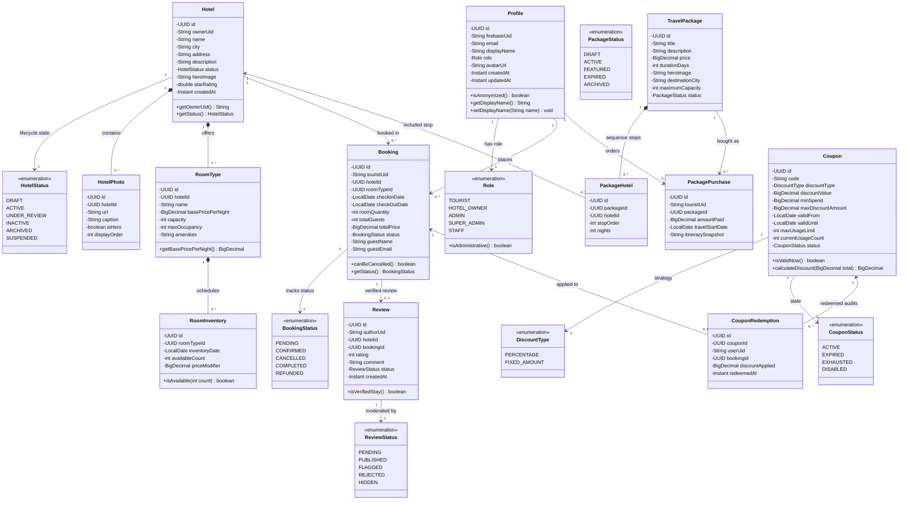

# waYcation 2.0: Complete System Class Diagram & OOP Architecture

This document contains the complete **UML Class Diagram** for all 6 modules of the waYcation 2.0 system.

---

## 1. Complete UML Class Diagram (Mermaid)

---

## 2. How to Export or View This Class Diagram

You have 3 easy ways to get and display this diagram for your project submission:

### Method 1: Mermaid Live Editor (Free Online PNG/SVG Export)
1. Copy the code block starting from `classDiagram` above.
2. Go to: **[https://mermaid.live](https://mermaid.live)**
3. Paste the code into the left editor.
4. The diagram will render instantly on the right.
5. Click **Download PNG** or **Download SVG** to insert it directly into your report or slides!

### Method 2: Visual Studio Code
1. Install the extension: **Markdown Preview Mermaid Support** (by Matt Bierner).
2. Open this markdown file in VS Code and press `Ctrl + Shift + V`. The diagram renders directly!

### Method 3: Draw.io / PlantUML
You can also import Mermaid syntax into [draw.io](https://app.diagrams.net) via **Arrange $\to$ Insert $\to$ Advanced $\to$ Mermaid**.
